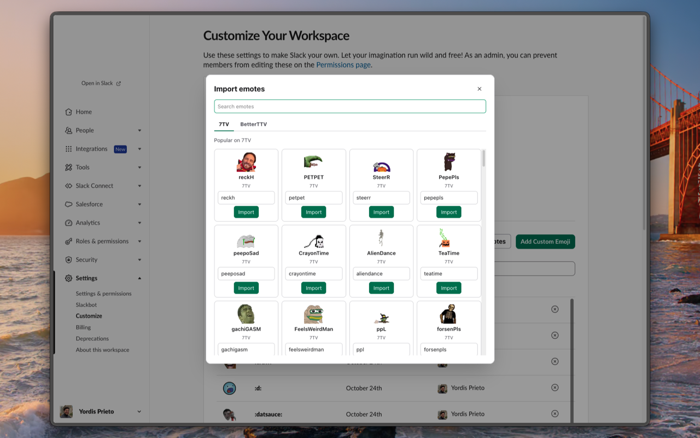

# Emote Importer Browser Extension

**Emote Importer is a browser extension, integrated with Slack, that brings Twitch emotes to your workspace in one click.** It runs on Chrome and Firefox-based browsers.

**It adds an Import emotes panel to your workspace's emoji page, where you browse popular 7TV and BetterTTV emotes or search for any of them.** Clicking Import adds the emote as a Slack custom emoji right away, using your own Slack session, so everyone in the workspace can use it.

**Slack only accepts custom emoji one image at a time, which means saving each emote, renaming it, and uploading it through a dialog.** Emote Importer removes those steps, so a workspace can adopt the emotes its people already know from Twitch without the busywork.

**It is useful for workspace members who are allowed to add custom emoji, especially in teams and communities that grew up around Twitch chat.** Anyone curating a workspace's emoji set can fill it with familiar reactions in minutes.

## Use

1. Open your workspace's emoji page, for example `https://<workspace>.slack.com/customize/emoji`.
2. Click **Import emotes** next to **Add Custom Emoji**.
3. Browse the popular emotes or search, pick the 7TV or BetterTTV tab, adjust the Slack name if you want, and click **Import**.

The emoji is added to the workspace right away and the emoji list refreshes.

## Configure

Open the extension popup to choose which sites to search and to add Twitch channels by numeric user ID. With an empty search, the import panel lists each site's global emotes and those channels' emotes first, followed by the site's popular emotes.

## Disclaimer

Emote Importer is not created by, affiliated with, or supported by Slack Technologies, LLC, 7TV, or BetterTTV. Emotes belong to their respective creators.
